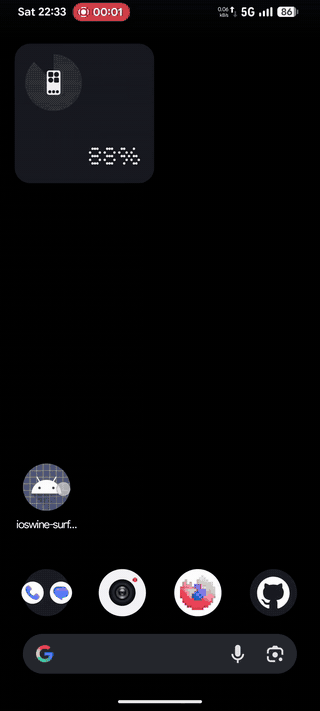

# ioswine

Run iOS apps on a rooted arm64 Android phone, the way Wine runs Windows programs on Linux.

Nothing is emulated. The app's arm64 code runs straight on the phone's CPU, on top of Apple's own frameworks from a real iOS image. ioswine replaces the bottom layer: the kernel interface, Mach IPC and the system daemons an iOS app expects to talk to.

<a href="docs/demo.mp4"></a>

## Status

The test app is [Aidoku](https://github.com/Aidoku/Aidoku), an open source manga reader. It boots to its first screen, draws through UIKit and SwiftUI with the iOS 26 Liquid Glass look, and takes touch input. Tabs switch and the UI redraws on change.

Still broken:

- random crashes after a while of tapping around (a memory or locking bug that is still being hunted)
- SF Symbols icons are missing
- networking beyond the basics
- the GPU path: CoreAnimation renders on the CPU for now

This is a research project. Don't run it on a phone you can't afford to wipe.

## How it works

- `loader/` is a static, freestanding Mach-O loader. It maps the app and Apple's dyld shared cache, applies fixups, re-signs arm64e pointers with the process's PAC keys, and rewrites thread-local storage access so it works on Linux. A seccomp filter catches any raw Darwin syscall that slips through.
- `libsystem_kernel/` is our replacement for Apple's lowest system library. BSD syscalls, Mach traps and ports, psynch locks, workqueues and kevent are rebuilt on Linux syscalls. It also stands in for the services an app connects to at launch: launchd, cfprefsd, notifyd, MobileGestalt, FrontBoard, RunningBoard, BackBoard HID and a few more.
- `android/surface/` is a small native Android app. It puts the app's frames on screen, sends touches and keyboard input back, and has a launcher screen.
- `gpu/` holds early work on a Metal-over-Vulkan path (AIR to SPIR-V, Turnip on Adreno). Not wired in yet.
- Everything above `libsystem_kernel` is Apple's unmodified code from an IPSW you supply.

[ARCHITECTURE.md](ARCHITECTURE.md) covers the design: address space layout, PAC handling, the TLS patching, the shared cache swap and the Mach IPC model.

## Requirements

- A rooted arm64 Android phone whose CPU supports pointer authentication (`paca` and `pacg` in `/proc/cpuinfo`). Development was done on a Snapdragon 8 Gen 1.
- Linux with Android NDK r28 or newer (`ANDROID_NDK_HOME`) and the SDK build tools for the APK.
- An iOS 26.6.2 (23G90) IPSW for iPhone17,3. Extract its dyld shared cache into `vendor-local/`, which is gitignored. No Apple binaries are in this repository.
- An unencrypted iOS app (`.ipa`) you have the right to run.

## Building

```sh
make              # loader and libsystem_kernel.dylib
make surface-apk  # Android presenter app
make host-tests   # unit tests that run on the PC
```

`tools/mksysroot.sh` builds the small iOS file system the app expects to find.

## Running on a phone

```sh
cp tools/device.env.example tools/device.env   # set DEV_SERIAL to your adb serial
tools/release.sh
```

`release.sh` builds everything, pushes it to `/data/local/tmp/ioswine` and installs the launcher. Open the launcher and tap Launch. It needs root and sets SELinux to permissive while the app runs, then puts it back.

Nothing outside `/data/local/tmp/ioswine` is changed. You are still running a lot of reverse engineered system code as root, so a spare phone is the better choice.

## Testing on a PC

There is a qemu-user path for reproducing crashes without the phone. It needs qemu 11 with a small patch for the arm64e PAC prctl calls.

- `tools/qrun SECS` boots the app under qemu and logs to `q.log`
- `tools/qtap OUTDIR "tap X Y" shot` drives the UI and saves screenshots
- `tools/qexplore SEED SECS` taps around at random and records every crash

## Legal

ioswine contains no Apple code. It is an interoperability project: you bring your own copy of iOS and of any app you run with it.
